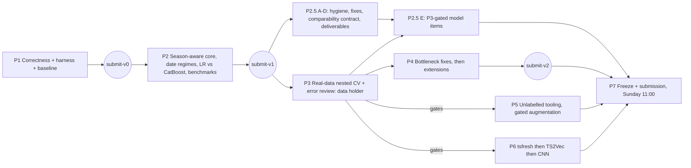

# AIL PV detection — implementation plan v3.1

Supersedes v3, v2 (`local://ail-pv-plan-v2.md`) and v1 (`local://ail-pv-milestone1-plan.md`). Repo: `neural-wave/ch-TokenLarpers`, branch `Jeffremm10/new-stack`. P1–P2 are implemented (tags `submit-v0`, `submit-v1`); v3.1 adds phase P2.5 from review round 4.

## 0. Decisions and audit

### 0.1 User decision: no isolation gate

The user dropped the isolation gate (encrypted image, existence check, outside-repo guards).
- **Residual risk:** PDF §6.3 says AIL data "must not be … made accessible to … coding agents, even if anonymized". This is the user's risk to accept.
- **Mitigation built into the plan:** no agent step needs real data. Agents develop and test on synthetic data; real-data commands (P3, P7) are run by the user.

### 0.2 Facts verified in the PDF (v1.5)

|Fact|Source|Effect on the plan|
|---|---|---|
|40 dev, 20 hidden, 1148 unlabelled customers|p.1, §3.1|Validation runs on 40 customers; the hidden score moves about 5 points per flipped TP|
|Labelled period 2022-01-01 to 2025-12-31, coverage varies per customer|§3.1, §6.2|The generator spans 2022–2025 with varying start/end|
|Measurement is "consumption/grid withdrawal recorded by the metering system"|§3.3|Negative readings aren't guaranteed, so export features are switched on by a data test|
|1 dev extension customer; 2 hidden extension customers, one with 2 events|§2|Tests cover a two-extension customer and an extension within a year of install|
|Unlabelled use is optional; hidden customers are excluded from it|§3.3, §3.5|Unlabelled data feeds label-free options only, which must pass a sensitivity test (Step 18)|
|Semicolons and a decimal point, despite the comma examples|§4.1|Unchanged|
|Commissioning date = "date from which the PV installation starts to influence the observed consumption"|§6.1|Dates come from the profile change, with three date regimes (Step 9)|
|Extension FPs never reduce the main score|§4.3|The bonus has positive expected value; it is built after core validation (P4)|

### 0.3 Review round 1 (applied in v2, kept)

|#|Point|Verdict|Resolution|
|---|---|---|---|
|1|Isolation|Correct; overridden by the user|§0.1|
|2|Selection on the same 40 OOF predictions|Correct|One `Procedure.fit` holding every automatic choice, evaluated by nested CV (§2)|
|3|Date detector not season-aware|Correct|Climatology-deseasonalized signal, a recurrence test, and a year-over-year confirmation (Step 8)|
|4|No hard negatives; synthetic data unused for training|Correct|Generator v2 with 7 confounder kinds; augmentation gated (Step 19)|
|5|Negative readings unconfirmed|Correct|Automatic signed-data test (Step 10)|
|6|Milestone 3 too big; LOO vs 5-fold not comparable; TS2Vec transductive|Correct|Gated P6, identical outer splits, unlabelled-only pretraining|
|7|Extensions within the first year|Correct|Path B detector plus tests (Step 15)|

### 0.4 Review round 2 (applied in v3)

|#|Point|Verdict|Resolution|
|---|---|---|---|
|2|v2 picked the climatology source (P5) and adopted candidates (P6) using outer scores; a bootstrap on the same predictions can't validate a choice|Correct. v2 used outer results for adoption in two places|§2 selection policy: automatic choices live only in inner CV. Candidates become inner-CV options. Outer-informed human decisions are logged in `DECISIONS.md`, and every estimate prints `outer_informed_decisions=k` with a "selection-biased" label when `k > 0`. The bootstrap is kept only as an inner stability heuristic|
|3|The first-date fallback is accurate only by accident|Correct|Three date regimes (`event`, `present_at_start`, `insufficient`), each with its own estimator, learned fold-safe. Nested CV reports `D` per regime and a regime confusion table (Step 9)|
|4|"Low seasonal contrast" as a proxy for "no PV" is unproven|Correct. Contrast also comes from heating, cooling and commercial schedules|Default climatology uses only labelled training-fold non-PV customers. Unlabelled-derived options become inner-CV options only after passing a filter-sensitivity test. They are never described as PV-free (Step 18)|
|5|Tests could become tuning targets for the simulator|Correct|Four evidence tiers (§3). Generator variant B with held-out confounder kinds and a seed block run only at phase gates and logged. Augmented descendants are grouped with their source customer (Step 19)|
|—|Memory of the 2M-row chunk dict accumulator|Correct; dicts of Python objects would bloat|Typed numeric parsing, 500k-row chunks, groupby partial sums compacted into arrays, peak RSS printed and capped on a synthetic run before the real run (Step 17)|
|—|Extensions after core validation; stress tests are a strong priority; tsfresh → TS2Vec → CNN last|Agree|P2 includes the benchmark suites and STOPs for P3. P4 handles core bottlenecks before extensions. P6 is sequential and gated|

### 0.4b Review round 3 (targeted corrections)

|#|Point|Verdict|Resolution|
|---|---|---|---|
|2|tsfresh `ds` kind depends on the label-fitted climatology, so a global cache leaks|Correct|`ds` removed from the cached tsfresh kinds. §2 gains a cache rule: only label-free quantities are cached, and anything depending on a fitted artifact is computed inside `fit`/`predict` with that fit's artifact (Step 20)|
|3|CNN used 3-fold inner CV vs up to 5 for the others|Correct|Every Tier A option, the CNN included, is compared on the same `inner_splits` customer folds. Windows are grouped by customer, and `fit` asserts it (Step 22)|
|4|The benchmark workload could swallow the hackathon|Correct: 8 scenarios × 40 customers × nested CV|Mandatory pilot: one scenario at reduced size; the module projects full time and memory and refuses a full run over budget without `--force` (Step 13)|

### 0.4c Review round 4 (team review of `docs/OVERVIEW.md` and the workflow proposal; applied in v3.1)

|#|Point|Verdict|Resolution|
|---|---|---|---|
|1|The learned date offset drops errors over 60 days and caps at ±21 days, so a months-long label lag cannot be learned|Correct (`procedure.py:102,107`)|Widen to errors ≤180 days, cap ±120, keep shrinkage. No summer/winter split: 22 positives per season and regime leave a handful per cell (Step 2.5-B1)|
|2|Inner scores are recorded but the inner-vs-outer gap is never printed|Correct|Print `inner=` and `gap=` on the `nested:` line (Step 2.5-B2)|
|3|`OVERVIEW.md` names a "shoulder-hour deficit" feature that does not exist|Correct|Correct the doc (Step 2.5-B3)|
|4|The benchmark report on `time-series-embeddings` publishes real customer IDs, per-customer values and a date; the repo is open-sourced after Sunday 11:00|Correct; active rule violation|Scrub it and add a commit-time hygiene check; the hand-in is an export of the final tree, not this history (Step 2.5-A)|
|5|Six branches with separate loaders, splits and scoring make results incomparable|Correct|Not a package merge now: one shared split file, one prediction contract, one scorer (Step 2.5-C). Merge packages only after deliverables are safe (Step 2.5-F)|
|6|Calibration on 32 training customers is noise|Agree|Dropped unless P3 shows unstable thresholds (Step 2.5-E4)|
|7|PatchTST score as an option needs three preconditions: fix the late-install aggregation blind spot, measure per-fold training time (~120 trainings per nested run), accept torch in the submission environment|Agree|Last model item, only if P3 names F1 as the bottleneck (Step 2.5-E5)|
|8|Every precision/recall item needs the real-data baseline (P3) first|Agree|P2.5-E items are gated on P3. P3 runs as soon as the data holder is ready; until then only P2.5-A to D proceed|

### 0.5 Gaps found before review (kept from v2)

1. Night-load confounders (EV, heat pump, night-tariff boiler) reduce `log(mid/night)` the same way PV does, so selectivity features are added (Step 10).
2. F1 is a set-level metric, so `main_score` is always computed on pooled predictions.
3. The v1 extension capacity ratio compared different seasons; it is now season-normalized (Step 15).
4. A capacity factor κ, chosen in inner CV, matches the APE-based `P`.
5. Selection-stability counts.
6. A leakage canary test.
7. Pinned dependencies, deterministic inference and a runtime budget.

## 1. Phases



|Phase|Runs|Priority (review round 2)|Output|
|---|---|---|---|
|P1|Agent, synthetic|1 Ingestion, DST, scoring, tests|`submit-v0` (done)|
|P2|Agent, synthetic|2 Season-aware detection, 3 LR vs CatBoost, 6 benchmarks|`submit-v1` (done)|
|P2.5|Teammate + agent; A–D need no real data, E needs P3|Review round 4|Hygiene, three fixes, shared contract, deliverables skeleton, gated model options|
|P3|Data holder, real data|4 Nested validation and error review|Bottleneck and gates, logged in `DECISIONS.md`|
|P4|Agent|5 Extensions, after any P3-named core fix|`submit-v2`|
|P5|Agent, gated|Unlabelled tooling, augmentation|Inner-CV options|
|P6|Agent, gated|7 tsfresh, 8 TS2Vec, 9 CNN|Inner-CV options|
|P7|User + agent|Freeze|Submission|

Rules for every step: `pytest -q` stays green; each tag is fully submittable; no step lowers a test threshold to make it pass.

## 2. Selection policy (binding)

- **Tier A, automatic choices:** classifier kind, threshold, capacity kind, κ, date offsets, regime parameters, climatology source, extra feature blocks, date source.
  - All of these happen **only** inside `Procedure.fit`, chosen by inner CV on that fit's training customers.
  - The outer nested-CV score is an honest estimate of the *whole procedure*, including its option pool.
  - The final model is the same procedure fit on all 40.
- **Tier B, design decisions informed by outer results:** P3 error review, feature redesign, gate decisions, changing an option pool, any comparison of two nested runs.
  - These are allowed, but each one appends one line to `DECISIONS.md`: `- YYYY-MM-DD | decision | outer results consulted`.
  - `train.py --cv` counts these lines and prints `outer_informed_decisions=k`. When `k > 0` it labels the estimate `selection-biased`.
  - No candidate is ever *adopted* by comparing outer scores. Unlocking a candidate (Tier B) only adds it to the inner option pool; inner CV then decides per fit.
- **Bootstrap `P(diff > 0)`:** used only inside inner selection, as a stability heuristic alongside the margin. It is never computed on outer predictions and never cited as validation.
- **Outer CV is computed once per code state for reporting.** Rerunning it to compare variants is Tier B.
- **Feature cache rule:** `FeatureTable` and any other cross-fold cache hold **label-free** quantities only (raw signals, `s`, `mid`, `night`, `eve`, `zero`, `early_contrast`, label-free tsfresh kinds, TS2Vec embeddings, CNN windows). Anything that depends on a fitted artifact (climatology, `ds`, `yield_shape`, regime cut, PCA, feature selection, scalers) is computed inside `fit`/`predict` with that fit's artifact. Enforced by the label-flip invariant test (P2 verification): changing a held-out customer's label must not change any prediction in its outer fold.
- **Common inner splits:** every Tier A option, from logreg to the CNN, is scored on the same `inner_splits` customer folds of a given fit. No option may use its own fold count, and no split may separate one customer's windows or augmented descendants.

## 3. Evidence tiers (binding)

|Tier|What|Where|Allowed use|
|---|---|---|---|
|U, unit|Deterministic contract and algorithm checks on hand-built arrays or tiny fixtures|`tests/`|Exact asserts; always run|
|R, synthetic regression|Fixed **dev** seeds (< 1000), generator variant A|`tests/`|Catch regressions; never evidence of accuracy; tolerances fixed in this plan|
|G, synthetic generalization|Generator variant B (independent PV, cloud and load families, plus confounder kinds absent from A), seed block from `benchmarks/HOLDOUT_SEED_BLOCK` (starts at 10000)|`python -m pvdetect.benchmark --suite holdout --log benchmarks/LOG.md`|Run only at phase gates (end of P2, P4, P7). Results are appended with the git SHA. A code change made in response burns the block (+10000) and adds a `DECISIONS.md` line|
|E, real|Nested CV on the 40 dev customers|P3 and P7 (user)|Primary evidence|

## Phase 1 — Correctness, harness, baseline

### Step 1 — Scaffolding

- **Python:** 3.12 (`uv venv --python 3.12 .venv`); README declares `>=3.10,<3.13`.
- **`requirements.in`:** `numpy>=1.26`, `pandas>=2.1`, `scipy>=1.11`, `scikit-learn>=1.4`, `ruptures>=1.1.9`, `tzdata>=2024.1`, `catboost>=1.2.7`.
- **`requirements.txt`:** `uv pip compile requirements.in -o requirements.txt --python-version 3.12` (exact pins, committed).
- **`requirements-dev.txt`:** `pytest>=8`, `matplotlib>=3.8`.
- **`pytest.ini`:** `testpaths = tests`.
- **`.gitignore`:** keep the existing line and add `artifacts/`, `predictions.csv`, `pv_extensions_predictions.csv`, `__pycache__/`, `.venv/`, `.pytest_cache/`.
- **Empty files:** `pvdetect/__init__.py`, `tests/__init__.py`.
- **`DECISIONS.md`:** header line `# Outer-informed decisions (Tier B)` only.
- **`benchmarks/HOLDOUT_SEED_BLOCK`:** `10000`. **`benchmarks/LOG.md`:** header only.
- **`IMPLEMENTATION_HANDOFF.md`:** a verbatim copy of this plan.
- **`CLAUDE.md`:** derived from `~/Downloads/AIL_CLAUDE.md`:
  - "Data handling":
    - agent work uses synthetic data only; real-data commands are run by the user;
    - no LLM in the pipeline; no weather, location or irradiation data; offline inference; calendar features only; augmentation only after organizer approval.
  - "Selection and evidence": §2 and §3 of the handoff verbatim; "never run the holdout suite outside a phase gate".
  - "What exists": "Built from scratch per `IMPLEMENTATION_HANDOFF.md`; nothing is competition-validated."
  - "Your immediate task": "Execute P1–P2, run the P2 gate benchmark, then STOP and report changed files, tests, benchmark results and risks."
  - Keep "Exact submission contract" and "Engineering bar" verbatim.

### Step 2 — Synthetic generator, variant A (`pvdetect/synthetic.py`)

```python
@dataclass(frozen=True)
class PVSpec:
    date: str; kwp: float
    orientation: Literal["south", "east_west"] = "south"
    export: bool = False
    battery_kwh: float = 0.0
    extensions: tuple[tuple[str, float], ...] = ()   # (local date, total kWp after)

@dataclass(frozen=True)
class Event:
    kind: str; start: str; end: str | None = None; size: float = 1.0

@dataclass(frozen=True)
class CustomerSpec:
    customer_id: str; start: str; end: str
    profile: Literal["residential", "commercial"] = "residential"
    pv: PVSpec | None = None; events: tuple[Event, ...] = (); missing: bool = True

def generate_customer(spec: CustomerSpec, seed: int, variant: Literal["A", "B"] = "A") -> pd.DataFrame
```

**Output:** columns `customer_id`, `timestamp_local` (`%Y-%m-%d %H:%M:%S`, Europe/Zurich wall clock), `timestamp_epoch` (int seconds, interval start), `energy_consumption_kwh` (4 decimals).

**Time index:** `pd.date_range(Timestamp(start, tz="Europe/Zurich"), Timestamp(end, tz=…) + 1 day, freq="15min", inclusive="left")`, which gives 92- and 100-row DST days.

**Variant A load:** `rng = default_rng(seed)`; `h` = local fractional hour; `doy` = day of year.
- *Residential:* `k = U(0.6, 1.6)`, `b = U(0.05, 0.15)`, and
  `load = k*(b + 0.25*exp(-((h-7.5)/1)**2) + 0.4*exp(-((h-19)/1.5)**2) + 0.10*exp(-((h-12.5)/1.5)**2))`.
  Multiply by 1.15 on weekends.
- *Commercial:* `k = U(2, 8)`. Weekdays: `k*(0.1 + 0.5*sigmoid((h-7)*3)*sigmoid((18-h)*3))`. Weekends: `k*0.12`.
- *Both:* multiply by `(1 + 0.25*cos(2π(doy-15)/365))` and by `lognormal(0, 0.25, n)`.

**Variant A events** (`A_KINDS`): applied to load before PV, active on local dates in `[start, end)`; `end=None` means persistent, except `vacation`, which defaults to 14 days.
- `ev`: on 4 of 7 nights (seeded), add `size*0.25*3.7` kWh per slot for 3 h, starting uniformly in 22:00–01:00.
- `heat_pump`: add `size*0.25*max(0, cos(2π(doy-15)/365))*(1 + 0.3*[h∈6–9 or 17–21])`.
- `boiler_night`: move `2.5*size` kWh/day from 11:00–14:00 (slot floor 0.02) to 23:00–02:00. The daily total is preserved.
- `vacation`: multiply by 0.3.
- `home_office`: on weekdays 09–17, add `0.05*size` per slot.
- `vacancy`: multiply by 0.4.
- `ac`: for doy 152–243, 12–18 h, add `size*0.25*max(0, cos(2π(doy-200)/365))`.

**Variant A PV:** `hs` = UTC+1 hour.
- `hw = 4 + 2.5*cos(2π(doy-172)/365)` and `amp = 0.55 + 0.25*cos(…)`. For `east_west`, `hw *= 1.25` and `amp *= 0.85`.
- `shape = cos(π/2*(hs-12.5)/hw)**1.5` inside `|hs-12.5| < hw`, else 0.
- `cloud`: one draw `U(0.2, 1)` per day.
- `prod = kwp_t*0.25*amp*shape*cloud`, where `kwp_t` is the latest applicable capacity (initial or extension).
- *Battery:* the daily surplus charges up to `battery_kwh` and discharges 17:00–23:00.
- *Clipping:* `max(net, 0)` unless `export`.

**Missingness** (when `missing=True`): drop 0.5% of rows at random, drop one 5-day block, and append one exact duplicate row.

**`generate_dataset(n, seed, start="2022-01-01", end="2025-12-31", hard_negatives=True, with_extensions=False, variant="A", scenario="base") -> (ts, labels, ext_labels)`**
- **IDs and seeds:** IDs `f"{i:06d}"`; per-customer seed `seed*1000 + i`.
- **Coverage:** `cstart = start + U(0, 540)` days and `cend = end - U(0, 540)` days, extended so each series is ≥730 days.
- **Profile:** commercial if `i % 7 == 3`, else residential.
- **PV (even `i`):**
  - *Date:* 85% uniform in `[cstart+120, cend-150]`; 15% before `cstart` (`cstart - U(30, 400)`).
  - *Capacity:* `kwp = round(U(3, 15), 1)`, or `U(15, 60)` for commercial customers.
  - *Variants:* `export = (i % 8 == 0)`, `east_west = (i % 6 == 0)`, `battery_kwh = 8` if `i % 10 == 4`.
- **Hard negatives:** every non-PV customer gets one event of kind `KINDS[(i//2) % len(KINDS)]` (`KINDS` = `A_KINDS` or `B_KINDS` by variant), starting in `[cstart+120, cend-150]`. PV customers with `i % 6 == 2` get one as well.
- **Extensions:** when `with_extensions`, PV customers with `i % 12 == 6` get one extension at `pv_date + U(200, 500)` days with total `round(1.5*kwp, 1)`, if it falls inside the coverage.
- **`scenario`:** modifies the draws (Step 13).

**CLI:** `python -m pvdetect.synthetic OUTDIR --n 24 --seed 0 [--sep ,] [--no-hard-negatives] [--with-extensions]` writes `energy.csv`, `labels.csv` and `extensions.csv` (variant A only; variant B is reachable only through the benchmark module).

### Step 3 — Loading and DST-safe day matrix (`pvdetect/io.py`)

**`_sniff(path) -> (sep, decimal)`:**
- `sep` = `;` if the header line (read as `utf-8-sig`) contains `;`, else `,`.
- `decimal` = `,` only if `sep == ";"` and the first data row's energy field contains a `,`; else `.`.

**`_read(path, **kw)`:**
- `pd.read_csv(sep=sep, decimal=decimal, usecols=[customer_id, energy_consumption_kwh, timestamp_epoch], dtype={"customer_id": str}, encoding="utf-8-sig", **kw)`.
- Typed parsing (not `dtype=str`) keeps memory low (Step 17).
- The required-header check (`customer_id`, `energy_consumption_kwh`, `timestamp_local`, `timestamp_epoch`) runs first. If any are missing, raise `ValueError(f"missing required columns: {sorted(missing)}")`.

**`_parse_frame(raw) -> (frame, counts)`:**
- Strip ids.
- Energy: `to_numeric(coerce)` → float64; negatives kept; NaN rows dropped and counted.
- Epoch: `to_numeric(coerce)`; unit is ms if the median is > 1e11, else s; convert to `epoch_utc` floored to 15 min; bad rows dropped and counted.

**`load_timeseries(path) -> LoadedTimeseries(frame, customer_ids, report)`:**
- `customer_ids` = sorted unique ids before any drop.
- Duplicate `(customer_id, epoch_utc)` rows: keep the first and count. Sort the frame.
- `report`: `rows_total`, `rows_bad_epoch`, `rows_bad_energy`, `rows_duplicate`, `customers`, `day_length_counts{92,96,100,other}` (per customer and Europe/Zurich date), `customers_signed` (customers with ≥1% readings < 0).

**`load_labels(path)` / `load_extension_labels(path)`:**
- Same sniff, read with `dtype=str`.
- `pv_installed` accepts `TRUE/1/FALSE/0` case-insensitively; anything else raises `ValueError`.
- Dates: `%Y-%m-%d` with `coerce`. Capacities: float.

**`day_matrix(frame_one) -> (dates[D], M (n_days, 96))`:** fixed UTC+1, contiguous days, NaN where missing.

### Step 4 — Official scoring and output

**`pvdetect/scoring.py`**
- **`main_score(pred, truth)`:**
  - F1 on `pv_installed`.
  - Over TPs: `D_i = max(0, 1 - |days|/30)` and `P_i = max(0, 1 - APE/0.5)`. A missing, invalid or non-positive value scores 0 and stays in the mean.
  - `score = f1*(70 + 15D + 15P)`, or 0 when there is no TP.
- **`extension_bonus(pred_ext, truth_ext)`:**
  - Per customer, `linear_sum_assignment` with cost `|days|` if ≤30, else 1e6; assignments at 1e6 are dropped.
  - Unmatched predictions are FP and unmatched truths are FN.
  - `bonus = f1_ext*(7 + 1.5D + 1.5P)`, or 0 when nothing matches.
- **CLI:** `python -m pvdetect.scoring PRED TRUTH [--ext-pred P --ext-truth T]`.

**`pvdetect/output.py`** — `write_predictions` / `write_extensions`:
- `csv.writer`, `;`, `\n`, UTF-8, exact headers.
- `TRUE`/`FALSE`, `YYYY-MM-DD`, capacities `f"{x:.2f}"`, empty fields when FALSE.

### Step 5 — Evaluation harness and decision log (`pvdetect/evaluation.py`)

**Procedure contract:** `fit(table, labels, train_ids, *, inner=True) -> dict` and `predict(model, table, ids) -> (pred_df, ext_df)`. Every Tier A choice lives in `fit`.

**`outer_splits(labels, repeats=4, folds=5, seed=0)`:**
- `RepeatedStratifiedKFold(n_splits=min(folds, min_class), n_repeats=repeats, random_state=seed)`.
- `min_class < 2` → `ValueError("fewer than 2 customers in a class")`.

**`inner_splits(labels, train_ids, groups=None)`:**
- `StratifiedGroupKFold(n_splits=min(5, min_class), shuffle=True, random_state=0)`.
- Groups default to the customer id; augmented rows pass `source_id` (Step 19).

**`nested_cv(...) -> NestedResult`:**
- For each repeat: pool the outer test predictions, then compute one `main_score` (plus `extension_bonus` when extension labels are given) and per-regime `D` (Step 9).
- `NestedResult` fields:
  - `repeat_scores`;
  - `mean` and `sd`;
  - `ci90`: 1000 customer-bootstrap resamples (`default_rng(0)`) of the repeat-0 pooled predictions. This describes uncertainty only; it never decides anything;
  - `oof`;
  - `fit_infos` (selection records).

**`count_decisions(path="DECISIONS.md") -> int`:** counts lines starting with `- `.

### Step 6 — Baseline features, changepoint, procedure, CLIs

**`pvdetect/daily.py` — `daily_signal(dates, M)`**
- **Slot windows (UTC+1):** `mid` = slots 40–59, `night` = 0–19, `eve` = 76–87.
- **Columns:**
  - `mid`, `night`, `eve` (nanmeans);
  - `total` = nansum × 96 / count;
  - `zero` = fraction of mid slots ≤ 0.005;
  - `valid`: ≥16/20 mid and ≥16/20 night slots present;
  - `month`, `woy = min(isoweek, 52)`, `weekend`;
  - `s = log((mid⁺+0.01)/(night⁺+0.01))` and `s_eve` likewise.

**`pvdetect/changepoint.py`**
- **`refine_breakpoint(y, tau, half_window=45, search=10, min_seg=14) -> (t, gain)`:** two-segment SSE minimum.
- **`detect_commissioning(daily, clim)` P1 baseline (`clim` ignored):**
  1. Return `None` if there are fewer than 56 valid days.
  2. 7-day rolling median of `s`.
  3. `Binseg(l2, min_size=14).predict(n_bkps=3)`.
  4. Pick the candidate with max `drop`.
  5. `drop ≤ 0` → `found=False`; otherwise refine and return `found=True`.

**`pvdetect/features.py` (baseline):** `summer_dip`, `seasonal_contrast`, `summer_zero_frac`, `cp_drop`, `cp_gain`, `log_mean_daily_kwh`, `dip_kw`, `night_kw` (v1 definitions). Capacity features: `dip_kw`, `night_kw`, `log_mean_daily_kwh`.

**`pvdetect/pipeline.py`**
- **`FeatureTable`** (frozen): `ids`, `daily`, `matrices`, `raw_stats` (`neg_frac`, `q001`, `first_date`, `n_valid`).
- **`build_feature_table(loaded)`:** label-free.
- **`predict`:**
  - `pv_installed` = prob ≥ threshold, forced FALSE with no valid days.
  - TRUE rows always get a date and a capacity (`clip(κ*exp(reg), 0.5, 500)`, or `fallback_kwp`).
  - Numpy only; no sklearn at inference.

**`pvdetect/procedure.py` baseline:** imputer → scaler → `LogisticRegression(C=1, class_weight="balanced")`; Ridge(1.0) capacity on log1p features; threshold 0.5; κ=1; offset 0. Schema v1 JSON.

**`pvdetect/model.py` — `save_model` / `load_model`:**
- Missing file → `FileNotFoundError(f"model artifact not found: {path}")`.
- Wrong version → `ValueError(f"unsupported model version: {v}")`; referenced sibling files must exist.
- `CURRENT_VERSION` bumps on every schema change (clean cutover).

**`train.py`:** `--timeseries --labels --out [--ext-labels P] [--cv] [--outer-repeats 4] [--report-dir DIR]`.
- **Join:** labelled customers missing from the timeseries → `ValueError(f"{n} labelled customers missing from timeseries")`; unlabelled series ignored.
- **`--report-dir`:** writes `oof_repeat0.csv` (`customer_id;true_pv;prob;pred_pv;true_date;pred_date;date_err_days;pred_regime;true_regime;true_kwp;pred_kwp;ape;<features>`) and `fit_infos.json`.
- **Final model:** `fit` on all labelled customers, then save.

**`inference.py`:**
- `MODEL_PATH = Path(__file__).resolve().parent / "artifacts" / "model.json"`.
- Exactly one positional argument.
- Writes both files to the cwd. Lazy imports; no `synthetic` import.

**`train.py --cv` output** (aggregate scalars only):
```
data: customers=N labelled=L customers_signed=k/N export_enabled=… days92=a days100=b
nested: score=M±SD ci90=[lo,hi] f1=… D=… P=… outer_informed_decisions=k [selection-biased]
dates: event n=… D=… | present_at_start n=… D=… | insufficient n=… D=…
regime_confusion: event→event=a event→start=b event→insuff=c start→event=d start→start=e start→insuff=f
selection: classifier logreg=a/F catboost=b/F | capacity ridge=c/F catboost=d/F | threshold median=… [min,max] | kappa median=… | <other Tier A options>=counts
final: classifier=… threshold=… capacity=… kappa=… offset_days=… start_lag_days=…
```
Before P2, the `dates`/`regime_confusion` lines report the baseline: only `event` or `insufficient`.

### Step 7 — README (P1)

Purpose, rules, setup, train, inference contract, smoke commands, §2 and §3 in summary, status "submit-v0: baseline; synthetic-validated only".

### P1 verification

- **U:**
  - **`test_io.py`:**
    - DST day counts and 96 slots on 2024-03-31 and 2024-10-27.
    - `;` with comma decimals, `,` with dot decimals, and ms epochs all give an identical `frame`.
    - Leading zeros preserved; `rows_duplicate == 1`; the missing-column error.
  - **`test_scoring.py`:** the 85 / 68 / D=0-stays-in-mean / no-TP→0 cases; extension matching (`f1_ext = 2/3`; +31 d unmatched).
  - **`test_output.py`:** exact text `000123;TRUE;2023-04-10;8.00\n000124;FALSE;;\n`; the extension file is the header plus `\n`.
  - **`test_changepoint.py` (unit):** `refine_breakpoint` on a noiseless step array of length 200 at index 117 → `t == 117`, `gain > 0.99`.
  - **`test_evaluation.py`:** `count_decisions` on a temp file with 2 `- ` lines → 2.
- **R (dev seeds):**
  - Changepoint on PV dates 2022-09-05 and 2024-04-10 (kwp 8, seed 11, no hard negatives) → `found`, within ±10 days.
  - `dip_kw` kwp 10 > kwp 4.
  - **Leakage canary:** `generate_dataset(24, seed=1, hard_negatives=False)`, `repeats=2`: true labels → score ≥ 80; permuted labels (`default_rng(0)`, permuting all label columns together) → ≤ 60.
  - **End-to-end:**
    - train on seed 1, infer on seed 2 with `socket.socket` blocked → 12 unique ids identical to the input, exact header, `f1 ≥ 0.8`;
    - `main([])` and `main([a, b])` → `SystemExit(2)`.
- **Smoke:**
  - `python -m pvdetect.synthetic /tmp/pvsyn_train --n 24 --seed 1` and `… /tmp/pvsyn_test --n 12 --seed 2 --sep ";"`.
  - `train.py --cv` → the output lines.
  - Inference and scoring → 13 lines.
  - Clear `artifacts/`; commit; `git tag submit-v0`.

## Phase 2 — Season-aware core, date regimes, LR vs CatBoost, benchmarks

### Step 8 — Climatology and season-aware commissioning

**`pvdetect/season.py` — `Climatology` (frozen):** `s[52]`, `log_mid[52]`, `yield_shape[52] | None`, `source: str`.

**`fit_climatology(table, nonpv_ids, pv_dates) -> Climatology`** (`source="labelled_nonpv"`, the conservative baseline):
- *`s` and `log_mid`:*
  - per **labelled** non-PV training customer: valid days minus that customer's median, then the weekly median by `woy`;
  - across customers: median by `woy`, then a circular 5-week rolling median;
  - fewer than 3 customers → zeros.
- *`yield_shape`:*
  - per labelled PV training customer with ≥60 valid days after `date + 14`: the weekly median of `−(log_mid_ds(post) − pre_level)`, normalized to max 1;
  - across customers: median, then circular smoothing;
  - fewer than 5 customers → `0.55 + 0.25*cos(2π(woy*7 − 172)/365)`, normalized.
- Always fitted inside `fit`.

**`detect_commissioning(daily, clim)` v2.** Uses `ds = s − clim.s[woy−1]`; windows are calendar-day windows over valid days.
1. Return `None` if there are fewer than 56 valid days.
2. Candidates: `Binseg(l2, min_size=21)` on the 7-day rolling median of `ds`, `n_bkps = min(4, n//60)`.
3. For each candidate `τ`:
   - `step = median ds[τ−60d, τ) − median ds[τ, τ+60d)`;
   - `persist` = share of later months (≥10 valid days) whose median `ds` < pre-median[τ−180d, τ) − 0.05;
   - `recur` = max over `k ∈ {±1, ±2, ±3}` of `step` at `τ + 364k`, where both windows have ≥20 valid days (NaN if none);
   - `evidence = step − max(0, recur)`.
4. Among candidates with `persist ≥ 0.5`, take the max `evidence` → `best`; `found` iff `evidence ≥ 0.10`.
   - `weak` = `best` when not found; if no candidate has `persist ≥ 0.5`, the candidate with max `step > 0`; else none.
5. Refine the chosen (or weak) candidate with `refine_breakpoint(ds, …)`.
6. `yoy_step` = median of `s_d − s_{d−364}` for `d ∈ [τ, τ+120d)` with `d−364` valid and before `τ` (NaN if <20 such days).

**`Commissioning`:** `date`, `index`, `step`, `persist`, `recur`, `evidence`, `gain`, `yoy_step`, `found`, `weak_date | None`.

### Step 9 — Date regimes

**`assign_regime(cp, early_contrast, contrast_cut) -> Literal["event", "present_at_start", "insufficient"]`:**
- `event` if `cp.found`.
- Else `present_at_start` if `early_contrast` is finite and `≤ contrast_cut`. `early_contrast` = `seasonal_contrast` over the **first** 365 days of data (≥30 summer and ≥30 winter valid days).
- Else `insufficient`.

**Fitted in `fit` (fold-safe):**
- `contrast_cut = (median post-install seasonal_contrast of training PV customers with ≥365 post days + median seasonal_contrast of training non-PV customers) / 2`. Fewer than 3 in either group → `−inf` (regime disabled).
- `offset_event`: median(true − pred) over training `event` TPs with `|err| ≤ 60`, multiplied by `n/(n+5)`, clipped to ±21 and rounded.
- `start_lag`: median(first_date − true_date) over training PV customers with `true_date < first_date`, multiplied by `n/(n+5)`, clipped to [0, 365] and rounded. Fewer than 3 → 0.
- `insufficient_rule ∈ {"weak_candidate", "first_date"}`: chosen by inner `D` on inner TPs in the `insufficient` regime. Fewer than 3 such cases → `"weak_candidate"`.

**Date per regime:**

|Regime|Date|
|---|---|
|`event`|refined date + `offset_event`|
|`present_at_start`|`first_date − start_lag`|
|`insufficient`|`weak_date` (or `first_date` if None) per `insufficient_rule`|

**Validation:**
- Nested CV reports `D` per predicted regime over TPs, plus the regime confusion counts.
- True regime: `start` if `true_date < first_date`, else `event`. (An `insufficient` truth class doesn't exist; it is a prediction outcome.)
- A regime with high count but low `D` is a P3 finding. It is never hidden behind the overall `D`.

### Step 10 — Confounder-robust features (`features.py` v2)

**Signed-data test (in `fit`):** `export_enabled = customers_signed ≥ max(2, 0.1 × n_train)`. When false, `neg_frac`/`export_kw` and the export capacity model are dropped.

Shorthand: `last365` = valid days within 365 days of the last valid day; summer = months 4–9; winter = 11–2. Unmet conditions give NaN.

|Feature|Definition|Targets|
|---|---|---|
|`cp_evidence`, `cp_step`, `cp_persist`, `cp_recur`, `cp_gain`, `yoy_step`|From `Commissioning` v2 (0 when not found, NaN when None)|Season-aware detection|
|`sel_night`, `sel_eve`|`Δlog mid − Δlog night` and `Δlog mid − Δlog eve` at the chosen/weak `τ` (90-day medians)|Night/evening load confounders|
|`dtotal`|`Δlog total` at `τ`|Boiler shift vs PV|
|`cloud_var`|`log(MAD(Δlog mid) post / pre)` over summer days, 180 days each side|Cloud-driven variance from PV|
|`summer_ds`|Median `ds` over summer `last365`|Deseasonalized dip|
|`seasonal_contrast`, `early_contrast`|Median `s` summer − winter in `last365` / in the first 365 days|Regime and detection|
|`dip_center_hour`|Weighted centre (UTC+1 h, slots 6–18) of `max(0, winter_norm − summer_norm)` profile|Solar-noon centring|
|`summer_zero_frac`, `zero_window_h`|Mean `zero` in summer `last365`; mean contiguous hours ≤0.005 kWh around 12:30 over the top-quartile-`zero` summer days|Clipping and capacity|
|`log_mean_daily_kwh`, `night_kw`, `dip_kw`|As in v2|Scale and capacity|
|`log_kwp_phys`|`log(pre_mid_kw) − 1.5*log(cos(π/4*clip(zw, 0, 11)/6.5))` when `zw > 0`, else `log(dip_kw + 0.1)`. A hypothesis from the generator physics; the regressor weighs it|Capacity|
|`neg_frac`, `export_kw`|Only when `export_enabled`|Export|

`CAPACITY_FEATURES = (dip_kw, log_kwp_phys, zero_window_h, night_kw, log_mean_daily_kwh) [+ export_kw]`.

### Step 11 — Procedure v2 (`procedure.py`)

**`fit(table, labels, train_ids)`:**
1. `clim = fit_climatology(...)`; compute the features for `train_ids`.
2. Inner CV (`inner_splits`). Each inner fold refits the climatology and the regime parameters on its training part. Collect inner OOF outputs for every Tier A option. With `min_class < 2`, use the defaults (logreg, 0.5, ridge, κ=1, offsets 0, `weak_candidate`).
3. **Classifier:**
   - `logreg`: imputer → scaler → `LogisticRegression(C=0.5, class_weight="balanced", max_iter=2000)`.
   - `catboost`: `CatBoostClassifier(iterations=300, depth=3, learning_rate=0.05, l2_leaf_reg=5, auto_class_weights="Balanced", random_seed=0, thread_count=1, verbose=False, allow_writing_files=False)`.
   - Each candidate's inner score is `choose_threshold`'s maximum.
   - Order: simpler first. The next option replaces the current one iff its inner score is ≥ 2.0 higher **and** the inner paired bootstrap (B=500, seed 0) gives `P(diff > 0) ≥ 0.8`. The bootstrap is a stability heuristic on inner predictions only.
4. **Threshold:** `choose_threshold`, grid `0.20..0.80` step 0.05; ties → smallest `|t − 0.5|`, then higher `t`.
5. **Capacity:** `ridge` (plus `ridge_export` when `export_enabled` with ≥3 export positives) vs `catboost` regressor; catboost needs ≥0.03 more inner `P`. Then κ via `choose_kappa` (0.80–1.10 step 0.05, max inner `P`, ties → closest to 1.0).
6. **Dates:** fit the Step 9 parameters and choose `insufficient_rule`.
7. Final fit of the selected options on all `train_ids`; return the model with a `selection` record.

**Schema v2:**
```
{"version":2,"feature_names":[…],"capacity_feature_names":[…],"export_enabled":bool,
 "climatology":{"source":"labelled_nonpv","s":[52],"log_mid":[52],"yield_shape":[52]},
 "classifier":{"kind":…,"threshold":f,"logreg":{…}|null,"catboost_file":…|null},
 "capacity":{"kind":…,"ridge":{…},"ridge_export":{…}|null,"catboost_file":…|null,"kappa":f,"fallback_kwp":f},
 "date":{"offset_event":int,"start_lag":int,"contrast_cut":f,"insufficient_rule":str},
 "selection":{…},"extensions":{"enabled":false}}
```

**Runtime cap:** nested CV with 4 repeats must finish in ≤10 min on CPU for 40 customers; if not, cache Binseg candidates per climatology hash.

### Step 12 — Review plots (`pvdetect/review.py`)

`python -m pvdetect.review OOF_CSV --timeseries PATH --out-dir DIR` (Agg backend). For each customer, 3 panels:
- `s`/`ds` with the true date (solid) and predicted date (dashed), coloured by predicted regime;
- `4*mid` and `4*night` kW;
- YoY values.

### Step 13 — Benchmark suites (`pvdetect/benchmark.py`)

**Variant B generator** (inside `synthetic.py`, `variant="B"`). Independent model families; the pipeline never imports them.
- **PV:**
  - daylight length `L = 12 + 3.9*cos(2π(doy−172)/365)` h;
  - `shape = sin(π*(hs − (12.5 − L/2))/L)**1.2` inside daylight;
  - `amp = 0.5 + 0.3*cos(…)`;
  - clearness is AR(1): `k_d = clip(0.6 + 0.8*(k_{d−1} − 0.6) + N(0, 0.2), 0.05, 1)`, times hourly `lognormal(0, 0.15)`;
  - east-west: daylight-wide plateau with `amp*0.8`.
- **Load:** piecewise-linear daily archetypes with 4–6 seeded breakpoints, plus Poisson appliance spikes (rate 3/day, 1–2 kW, 15–45 min); weekly and seasonal multipliers drawn per customer.
- **`B_KINDS`** = `A_KINDS` plus held-out kinds absent from variant A:
  - `daytime_absence` (weekday 08–17 × 0.5, persistent);
  - `heat_storage` (winter night block, 6–8 kWh);
  - `pool_pump` (summer 10–16 fixed 1 kW);
  - `ev_daytime` (weekend 11–15, 7 kW for 2 h).

**Scenarios** (`scenario=`):
- `base`;
- `confounders_x2` (two events per non-PV customer);
- `east_west_heavy` (50%);
- `battery_heavy` (50%);
- `short_coverage` (300–540 days);
- `missing_5pct`;
- `commercial_heavy` (50%);
- `pv_before_start` (40%).

**Suites:**
- `--suite dev`: variant A, all scenarios, seeds 100–199. Free to use during development.
- `--suite holdout`: variant B, all scenarios, seeds from `benchmarks/HOLDOUT_SEED_BLOCK`.
  - Refuses to run without `--log PATH`; appends `date | git SHA | scenario | score f1 D P | regime D` rows.
  - Run only at the P2, P4 and P7 gates.
- Each scenario: `generate_dataset(n, …)`, `nested_cv(repeats=r)` with defaults `n=40`, `r=2`. Output is a table.

**Workload control (mandatory before any full run, dev or holdout):**
- `--pilot`: runs the `base` scenario only with `n=12`, `r=1`, timing data generation, feature building and fitting separately, and recording peak RSS.
- **Projection:** `projected_min = (fit_s × (n/12)² + prep_s × (n/12)) × r × scenarios / 60`. Quadratic for fitting because the inner CV scales with customers per fit, linear for preprocessing. It is printed alongside `peak_rss_mb`.
- **Budget:** a full run requires `projected_min ≤ --budget-min` (default 30) and `peak_rss_mb × 2 < 4000`; otherwise it refuses, printing the projection and suggesting `--scenarios`, `--n` or `--repeats` reductions, unless given `--force`.
- **Size flags:** `--scenarios a,b`, `--n`, `--repeats` let the gate run be sized deliberately. The size used is recorded in the `LOG.md` row.
- **Pilots draw on seeds 900–999** (dev range), so piloting never touches the holdout seed block.

**Gate rule:** if a holdout result prompts a code change, increment `HOLDOUT_SEED_BLOCK` by 10000 and add a `DECISIONS.md` line before rerunning.

### P2 verification

- **U:**
  - **`test_regimes.py`:** `assign_regime` on hand-built `Commissioning`/contrast values → each of the 3 regimes. `start_lag` with gaps `[30, 40, 50]` → `round(40*3/8) = 15`. `offset_event` with errors `[10, 12, 8, 11, 9]` → 5.
  - **`test_model.py`:**
    - `choose_threshold` tie case → 0.30.
    - `choose_kappa` with predictions 10% high → 0.90.
    - v1 JSON → `unsupported model version: 1`.
    - CatBoost save/load → identical probabilities.
    - `fit` twice → identical JSON.
  - **`test_season.py` (unit):** `fit_climatology` on 4 hand-built customers whose `s` equals a known weekly curve plus a customer offset → recovers the curve to 1e-9 (before smoothing, `smooth=False` keyword).
  - **`test_features.py`:** no signed customers → `export_enabled` false and the export features absent.
  - **`test_leakage.py` (label-flip invariant):** `generate_dataset(12, seed=4)`, one outer repeat. For one customer `x` in outer test fold `f`, flip `pv_installed` (and set/clear its date and capacity), then rerun the same splits. Every row of fold `f`'s predictions, `x` included, is identical to the original run. This catches any cache or transform fitted on held-out labels. It is rerun unchanged whenever P5/P6 add options.
- **R (dev seeds, variant A):**
  - The seasonal-false-drop customer (`ac` + heat pump, no PV): raw P1 scoring finds `drop > 0.10`; v2 with an 8-customer non-PV climatology gives `found=False` or `evidence < 0.10`.
  - Winter install 2023-12-05 → `event` regime, ±15 d.
  - `pv_date` 200 days before `start` → `present_at_start`.
  - `ev`/`boiler_night`/`heat_pump` non-PV customers → `cp_evidence < 0.10` or `sel_night > −0.2`.
  - End-to-end with hard negatives (seed 1 → seed 2) → `f1 ≥ 0.8`, and every TRUE row has a date and capacity > 0.
  - Leakage canary with v2.
- **Smoke:**
  - `train.py --cv --report-dir /tmp/pvsyn_report` → the output lines, including `dates:` and `regime_confusion:`.
  - `review` → 24 PNGs; open one with `read`.
  - `python -m pvdetect.benchmark --suite dev` → the table.
- **Gate (G):** `python -m pvdetect.benchmark --pilot`, then `python -m pvdetect.benchmark --suite holdout --log benchmarks/LOG.md` sized to the projection, run once.
- **Finish:** clear `artifacts/`; commit; `git tag submit-v1`.

**STOP. Report** changed files, tests, the dev and holdout benchmark tables, and risks. Hand off for P2.5 and P3.

## Phase 2.5 — Review round 4: hygiene, fixes, comparability, deliverables (teammate implements)

Order and timing (deadline: everything published by **Sunday 11:00**):

|When|Steps|Needs real data?|
|---|---|---|
|Now|A (hygiene), B (three fixes)|No|
|As soon as the data holder is ready|P3 (unchanged, below)|Yes|
|Today/tomorrow|C (shared split file, prediction contract, scorer)|No to build; yes to compare pipelines|
|Saturday|D (deliverables skeleton), then E items that P3 justifies|D no; E yes|
|Sunday morning|G (freeze, final run, publish before 11:00)|Yes|
|Only after D is safe|F (package merge, CI)|No|

Rules for P2.5: `pytest -q` stays green after every step; each step is its own commit; no step changes a Tier A margin or test threshold.

### Step 2.5-A — Data hygiene (now)

- **Scrub `benchmarks.md`** on `time-series-embeddings` (owner: its author). Keep aggregate metrics only. Remove:
  - customer IDs (`POD\d+`);
  - per-customer energy values, probabilities and dates;
  - the per-customer "wild" tables.
- **Hygiene check:** `scripts/check_hygiene.py`, run as a local git pre-commit hook (`scripts/install_hooks.sh` copies it to `.git/hooks/pre-commit`) and later in CI. It fails if any staged file:
  - matches `*.csv`, `*.parquet`, `*.cbm`, `*.pt` or anything under `artifacts/`;
  - contains the regex `\bPOD\d+\b` (real unlabelled IDs). Synthetic IDs are 6-digit numbers, and the bare word `POD` in the organizer filter rule doesn't match.
  - Exit code 1 with the offending paths. The message never prints the matching line content.
- **Hand-in:** the NW_26 repo receives an export of the final tree (`git archive` of the frozen commit), never this history, so scrubbed content in old commits is not published.
- **Organizers (user):** ask whether semi-synthetic augmentation of the provided series is allowed (unblocks Step 19).
- **Acceptance:**
  - `tests/test_hygiene.py` stages, in a temp git repo, a file containing `POD12` → exit 1; a `.csv` file → exit 1; a clean `.py` file → exit 0.
  - `README.md` documents `scripts/install_hooks.sh`.

### Step 2.5-B — Three fixes from the review (now)

**B1. Learnable label lag** (`pvdetect/procedure.py`, `fit_date_params`):
- Add module constants:
  - `OFFSET_ERROR_WINDOW = 180`: detected events whose error vs the label is within ±180 days contribute; was 60.
  - `OFFSET_CAP = 120`: `offset_event = shrunk_median(errs, -OFFSET_CAP, OFFSET_CAP)`; was ±21.
- Comment: labelled commissioning dates may lag the visible onset by months.
- No season or regime split. A seasonal offset becomes a Tier A option only if P3 shows a seasonal date-error pattern (logged in `DECISIONS.md`).
- **Acceptance** (`tests/test_regimes.py`, behaviour test through `fit_date_params` with a minimal stub table):
  - 10 PV customers whose detected date is the label minus 90 days → `offset_event == 60` (= round(90·10/15)). The old rule gives 0, so this catches a regression.
  - 2 such customers → `offset_event == 26`.
  - Mixed errors `[0]*8 + [150]*2` → `offset_event == 0` (the median stays robust to two misdetections).

**B2. Inner-vs-outer gap** (`pvdetect/procedure.py` `_select`, `train.py`):
- `_select` adds `"inner_score"`: the inner score of the selected classifier at its chosen threshold (`s_lr` or `s_cb`). It is NaN when inner CV is skipped.
- The `nested:` line adds `inner=<mean inner_score over all outer fits> gap=<inner − nested score mean>`. A NaN inner prints `inner=nan gap=nan`.
- README: a gap above about 5 points means the in-fit selection is optimistic. Read it alongside selection stability.
- **Acceptance:** the synthetic smoke `train.py --cv` prints finite `inner=` and `gap=`. No new permanent test, because it is formatting only.

**B3. Doc correction** (`docs/OVERVIEW.md`):
- Replace "a shoulder-hour deficit that maps to kWp" with "capacity from the midday pre-vs-post dip and a physics kWp estimate from the pre-install midday level and the width of the zero-reading window around solar noon".

### Step 2.5-C — Comparability contract (one split file, one prediction file, one scorer)

Goal: every pipeline (pvdetect, PatchTST, anything later) is scored identically on identical customer folds. No package merge.

**C1. Shared split file**
- Produced by `main`'s `python -m neuralwave_data.prepare ... --folds 5 --seed S`, which writes `splits.parquet` with columns `customer_id` (string) and `fold` (int64).
- Seeds 0, 1, 2 give three repeat files.
- `train.py --folds PATH[,PATH...]` reads each file (parquet via `pyarrow`; CSV with the Step 3 delimiter sniff) and uses it as one outer repeat, instead of `RepeatedStratifiedKFold`.
- Add `pyarrow` to `requirements.in` and recompile `requirements.txt`.
- Validation: every labelled customer has exactly one fold. Otherwise raise `ValueError(f"split file {path} does not cover labelled customers: {n} missing")`. Extra IDs are ignored.

**C2. Shared out-of-fold prediction file**
- `train.py --cv --oof-out PATH` writes one semicolon CSV over all repeats, using the `predictions.csv` formatting rules (TRUE/FALSE, `YYYY-MM-DD`, empty date and capacity when FALSE).
- Columns: `customer_id;repeat;fold;prob;pv_installed;pv_installation_date;pv_capacity_kwp`.
- No true labels, features or regimes in it. Those stay in the private `--report-dir` output.
- Detection-only pipelines (current PatchTST) write empty date/capacity. They then score D = P = 0, and the comparison reports F1 separately so detection is still comparable.

**C3. Scorer:** `python -m pvdetect.compare --labels LABELS OOF1 [OOF2 ...]`.
- For each file and each repeat, compute the official `main_score` on that repeat's pooled rows.
- Print one line per file: `file=<name> repeats=k score=M±SD f1=… D=… P=…`.
- When two or more files share repeats and folds, also print `paired: <A> vs <B> mean_diff=… repeats_A_better=a/k`.
- Aggregates only; never per-customer rows.
- Any comparison used to choose a design is a Tier B decision: log it in `DECISIONS.md`.

**C4. PatchTST on the shared contract** (owner: its author)
- Rerun on the three shared split files.
- Thresholds are tuned on training customers only (already the case).
- Write the C2 file.

**Acceptance (U tests):**
- `--folds` with a split file missing one labelled customer raises the C1 message.
- A C2 file written for a hand-built 4-customer case scores identically through `pvdetect.compare` and `python -m pvdetect.scoring` (repeat filtered).
- Synthetic smoke: `train.py --cv --folds f0.csv,f1.csv --oof-out oof.csv`, then `python -m pvdetect.compare --labels labels.csv oof.csv`, prints one `file=` line with 2 repeats.

### Step 2.5-D — Deliverables skeleton (Saturday; required by `guidelines.md` on `main`)

- **`README.md`:** add every member's full name and role.
- **`report/REPORT.md`:** an outline of at most 3 pages, with sections Title, Approach, Results, Challenges (including what didn't work), and AI agents/LLM usage. Results is filled from P3/P7 aggregate numbers only.
- **`report/VIDEO_SCRIPT.md`:** a 2-minute script covering goal and relevance, the method in one diagram, key results, and a demo of `python inference.py test.csv`.
- **Clean-environment install test**, documented in the README:
  ```
  uv venv /tmp/cleanroom --python 3.12
  uv pip install --python /tmp/cleanroom/bin/python -r requirements.txt
  ```
  Then run the synthetic smoke inference from a temporary directory. It must succeed with plain `pip install -r requirements.txt`.
- **Export procedure:** `git archive <frozen commit> | tar -x -C <NW_26 repo checkout>`, then commit there.

### Step 2.5-E — Model items (only those P3 justifies; all are Tier A options inside `Procedure.fit`)

Every item is added to the inner option pool. Inner CV chooses per fit with the Step 11 margin rule; outer scores never adopt it. Order:

**E1. Persistence feature `summer_suppressed_week_frac`** (`features.py`, fitted part, because it uses `ds`):
- Count the summer ISO weeks in `last365` with ≥4 valid days.
- The feature is the fraction of those weeks whose weekly median `ds` is ≤ (median `ds` over winter days in `last365`) − 0.5.
- NaN if there are fewer than 8 such weeks or fewer than 30 winter days.
- Targets vacations and short shutdowns, which suppress only a few weeks.
- R test: a customer with a 3-week `vacation` and no PV scores < 0.2; a summer-installed PV customer scores > 0.8.

**E2. Probability averaging:** a third classifier option `avg` = mean of the logreg and CatBoost inner OOF probabilities.
- Selected only if it beats the current best by ≥2.0 inner points with bootstrap ≥0.8.
- The final model stores both sub-models. `model.json` `classifier.kind = "avg"`.

**E3. Repeated inner CV:** `inner_splits` returns 3 repeats × `min(5, min_class)` folds (shuffle seeds 0, 1, 2).
- Inner OOF predictions are averaged per customer across repeats before selection.
- The cost is about 3× fit time: rerun `python -m pvdetect.benchmark --pilot`, and if the projection exceeds the budget use 2 repeats.
- The label-flip leakage test must still pass unchanged.

**E4. Probability calibration:** not implemented. Revisit only if the P3 `selection:` line shows a threshold range wider than 0.3 across outer fits (logged).

**E5. PatchTST customer score as a feature option.** Last, and only if P3 names F1 as the bottleneck. Preconditions, each verified and recorded before integration:
1. **Fix the late-install blind spot.** The P90 over all April–September windows dilutes installs with few post-install summer weeks. Use the P90 over windows in the customer's last 365 days of summer coverage, and add an R test with an install 10 weeks before the series end.
2. **Timing.** Per-fold training time × (outer folds × repeats × (inner folds + 1)) must fit the benchmark budget (about 120 trainings per nested run at 5×4 outer, 5 inner). Measure with the pilot first.
3. **Dependencies.** `torch` (CPU wheel) is accepted in `requirements.in`, and the inference runtime limit (P7, < 120 s for 20 customers) still holds.
- The network trains inside each fit on that fit's training customers only (window labels per Step 22), on the common inner folds.

### Step 2.5-F — Package merge and CI (only after Step 2.5-D is safe)

- **One `pyproject.toml` with a `src/` layout.** `pvdetect` moves next to `neuralwave_data`.
- **One loader,** following `main`'s stricter rules:
  - explicit delimiter/decimal config;
  - conflicting duplicate rows raise an error;
  - the organizer `POD`-prefix filter, for unlabelled sources only.
- **CI:** a GitHub Actions workflow running `pytest -q`, `ruff check` and `scripts/check_hygiene.py` on every PR. Merges go through reviewed PRs.
- **Acceptance:** all existing tests pass after the move, and inference output is byte-identical on the synthetic smoke set before and after.

### Step 2.5-G — Freeze (Sunday morning)

- Final real-data `train.py --cv` on all 40, then P7 checks 3–7.
- Fill the report Results section from aggregate lines.
- Export to the NW_26 repo and publish before **11:00**.

## Phase 3 — Real-data evaluation (user)

```
python train.py --timeseries <dev energy> --labels <dev labels> --ext-labels <dev ext labels> \
  --out <private>/model.json --cv --report-dir <private>/report
python -m pvdetect.review <private>/report/oof_repeat0.csv --timeseries <dev energy> --out-dir <private>/plots
```

**Error taxonomy (counts):**
- FN by cause: winter install, short post coverage, small dip vs load, `present_at_start`, battery-like evening drop.
- FP by suspected confounder.
- `D` by regime, plus the regime confusion.
- Capacity APE by load level and clipping.
- The signed-data line; selection stability.

**Bottleneck:** the largest of `70*(1 − f1)`, `15*f1*(1 − D)`, `15*f1*(1 − P)`. These are the score points lost per component.

**Gates.** Each decision becomes one `DECISIONS.md` line.

|Condition|Unlocks|
|---|---|
|Bottleneck named|P4a fix targeted at it|
|`f1 < 0.90` with misses not explained by known confounders|P6 Step 20 tsfresh option, then Step 21 TS2Vec option|
|`D < 0.60` with `event` regime D the driver|P6 Step 22 CNN date-source option|
|`P < 0.55`|tsfresh features as a capacity option|
|Unlabelled climatology is worth testing|P5 Step 18|
|Organizers approve synthetic augmentation|P5 Step 19|

Findings relayed to agents are generalized, e.g. "night-load FPs dominate", "`present_at_start` D is near 0".

## Phase 4 — Bottleneck fixes, then extensions (agent)

### Step 14 — P4a targeted fix (conditional)

- Implement only what the P3 bottleneck names, as a Tier A option inside `fit` wherever possible (e.g. an alternative refinement rule as an inner-CV choice).
- Add a dev-seed R test for the targeted pattern.
- Report that the next real nested estimate is `selection-biased` (k incremented).

### Step 15 — Extension detector (`changepoint.py`)

**`Extension(date, index, rise, capacity_ratio, path)`**

**`detect_extensions(daily, cp, clim, params)`:**
- `params = {"min_drop": 0.15, "min_rise": 0.25, "min_gap_days": 90, "max_events": 2}`.
- Return `[]` unless `cp.found`.
- **Path A (YoY):**
  - `y_d = s_d − s_{d−364}` on days with both valid and `d−364 ≥ date + 14`.
  - Return `[]` if `len < 60`.
  - 15-day median, then `Binseg(l2, min_size=30)`, `n_bkps = min(2, len//30 − 1)`.
  - Accept iff `drop ≥ min_drop` and `median(y[τ:τ+180]) ≤ −min_drop/2`. Date from `refine_breakpoint`.
- **Path B (season-normalized, first year):**
  - `q_d = (pre_level − ds_mid_d)/yield_shape[woy−1]` over valid days `≥ date + 14` with `yield_shape ≥ 0.3`.
  - `pre_level` = median pre-commissioning `ds_mid` (≥14 days), else the 90th percentile of post winter `ds_mid`.
  - Rolling 30-day 75th percentile, then `Binseg(l2, min_size=45)`, `n_bkps ≤ 2`.
  - Accept iff `rise ≥ min_rise*max(pre_q, 0.05)` and `median(q[τ:τ+120]) ≥ pre_q + 0.5*rise`.
- **Merge:**
  - A and B events within 45 days merge, keeping A's date.
  - Drop events before `date + min_gap_days`.
  - Of events closer than `min_gap_days`, keep the larger.
  - Keep the top `max_events`, then sort by date.
- **Capacity ratio:** `ratio_k = clip(median q[seg_k] / median q[seg_0], 1.1, 3.0)`, increasing by ≥1.1× per event; if `median q[seg_0] ≤ 0`, use `1.5^k`.
- **Output:** `pv_capacity_after_extension_kwp = predicted initial × ratio`, only for TRUE customers.

**Tier A:** `min_drop ∈ {0.15, 0.25}` is chosen in inner CV by `extension_bonus` only when the training customers contain ≥2 extension events. Otherwise it stays at 0.15. Dev has 1 extension customer, so in practice the default holds.

### Step 16 — Wiring

- **Schema:** v3 with `"extensions": {"enabled": true, …}`.
- **`train.py`:** `--no-extensions`; nested CV reports the pooled `extension_bonus` when `--ext-labels` is given.
- **`inference.py`:** writes the extension frame.

### P4 verification

- **R (`generate_customer`, 2022–2025, kwp 5, PV 2022-05-10):**
  - extension 2023-08-20 → 10: 1 event, ±15 d, ratio ∈ [1.3, 3.0];
  - extension 2022-12-10 (path B): 1 event, ±20 d;
  - extensions 2023-04-01 → 8 and 2024-06-15 → 12: 2 events, ±20 d each, increasing ratios;
  - no extension, for seeds 21, 22, 23 plus post-install `vacation` and `ac` → `[]`.
- **End-to-end:**
  - `with_extensions=True`;
  - exact extension header;
  - extension rows only for TRUE customers, capacity > initial;
  - P2 bars hold.
- **Gate (G):** the holdout suite with `with_extensions=True` scenarios, logged.
- **Finish:** commit; `git tag submit-v2`.

## Phase 5 — Unlabelled tooling and gated augmentation (only items unlocked in P3)

### Step 17 — Memory-bounded streaming

- **`io.iter_chunks(path, chunksize=500_000)`:** `_read(..., chunksize=…)` + `_parse_frame`; typed columns only.
- **`daily.DailyAccumulator`:**
  - Customer ids become integer codes via a growing dict (1148 entries).
  - Per chunk: compute `(code, std_day, slot)`, then one `groupby([code, day])` aggregating `mid_sum, mid_cnt, mid_zero, night_sum, night_cnt, eve_sum, eve_cnt, tot_sum, tot_cnt` into a numeric frame, appended to a list.
  - Every 10 chunks: `concat` + `groupby.sum` to compact.
  - `finalize()` → `dict[str, DataFrame]`, identical to `daily_signal(*day_matrix())`.
  - Expected state: ~1.6M customer-days × 9 float64 ≈ 115 MB.
- **`python -m pvdetect.unlabelled_audit --unlabelled P --timeseries DEV [--chunksize 500000]`:**
  - prints aggregate per-feature KS statistics (dev vs unlabelled);
  - prints `peak_rss_mb` (`resource.getrusage(RUSAGE_SELF).ru_maxrss / 2**20` on macOS) and the elapsed time.
- **Memory gate:**
  - Before any real run, run the audit on a synthetic file of 100 customers × 4 years (~14M rows), written via the synthetic CLI.
  - Acceptance: `peak_rss_mb < 1500`. If it fails, halve the chunksize and compact more often; the cap doesn't move.
  - The user then runs the real audit first, before any pretraining, and relays only `peak_rss_mb` and the elapsed time.

### Step 18 — Unlabelled-derived options, sensitivity-tested

- **Rule:** the conservative baseline (labelled non-PV climatology) is always available. No unlabelled filter is ever treated as "PV-free".
- **Candidate climatology `unlabelled_q`:** fitted on unlabelled series with `seasonal_contrast ≥` the q-quantile, for `q ∈ {0, 0.25, 0.5, 0.75}`.
  - *Sensitivity test:* `max_q,q' max_woy |c_q − c_q'| ≤ 0.05` (log units).
  - Pass → `unlabelled_0.5` is added to the inner-CV climatology options (Tier A, same margin rule as Step 11).
  - Fail → the option is disabled and the reason printed.
  - Saved in `clim_unlabelled.json` along with the sensitivity numbers.
- **Behavioural spread:** `spread[52]` = MAD across unlabelled customers of weekly-median `ds`. It is robust to a PV minority, but still contaminated, so it is an *option*, not a default.
  - Inner-CV option `evidence_scale ∈ {"none", "unlabelled_spread"}`, which divides `step`/`evidence` by `spread[woy]/median(spread)`.
- **Tests (U):**
  - the sensitivity test on hand-built climatologies that differ by 0.04 vs 0.06 → pass vs fail;
  - `fit` with options present but a stub inner score preferring the baseline → the baseline is selected.

### Step 19 — Gated augmentation (`pvdetect/augment.py`)

- **`inject_pv(frame, pv, seed)`:** applies variant A PV to a real series.
- **`train.py --augment N --organizer-approved-augmentation`:** both flags are required. `--augment` alone → `ValueError("augmentation requires --organizer-approved-augmentation")`.
- **Inside `fit` only:** create N semi-synthetic positives from training-fold non-PV customers and N synthetic hard negatives.
  - Each carries `source_id` (the source customer, or `syn_<k>` for pure synthetics).
  - Inner CV uses `StratifiedGroupKFold` on `source_id`, so descendants never straddle a split.
  - `fit` asserts `{source_id of augmented} ⊆ train_ids ∪ {syn_*}` and raises otherwise.
  - Validation folds are never augmented.
- **Tests (U):**
  - `--augment` without approval raises.
  - Augmentation with groups → no inner split has a `source_id` on both sides.
  - OOF ids == the labelled ids exactly.
- **Effect** is measured by the next nested run (Tier B decision to enable it, logged).

### P5 verification

- **`test_streaming.py`:** 3 `missing=False` customers, shuffled, `chunksize=5000` → equal to `daily_signal(*day_matrix)` per customer.
- **Memory gate (Step 17)** recorded in the report.

## Phase 6 — Advanced candidates (sequential, each only if its gate holds)

**Rules:**
- Each candidate is added as an **inner-CV option** of `Procedure.fit` (feature block or date source), selected per fit by the Step 11 margin rule.
- Unlocking is Tier B (logged). Adoption is never decided by comparing outer scores.
- Libraries are imported lazily. `requirements.in` gains the library when the option exists in the pool, so inference can always load whatever is selected.
- After each candidate, the next nested run's estimate covers the expanded procedure.
- Whether to continue to the next candidate is a gate re-check (Tier B, logged).

### Step 20 — tsfresh (priority 7)

- **Extraction:** `extract_tsfresh(table)` on `last365` valid days, label-free kinds `s`, `mid`, `night`, `zero` only; `EfficientFCParameters`; `n_jobs=0`; prefix `tsf__`. Fewer than 60 days → a NaN row. Runs once and is cached.
- **No `ds` kind:** `ds` depends on the fitted climatology (§2 cache rule). A `ds` kind would have to be extracted inside every `fit` and inner fold with that fit's climatology. It is excluded unless P3 findings justify that cost as a logged Tier B decision.
- **Selection inside `fit`:** `select_tsfresh(X, y, k=8)`.
  - Drop non-finite and constant columns.
  - `calculate_relevance_table`, keep `relevant`, sort by `p_value`.
  - `ValueError` → `[]`.
- **Model JSON:** `from_columns` settings plus the training medians.
- **Tests (U):** planted `y + N(0, 0.1)` column selected (length ≤ 8); 3 rows → `[]`.

### Step 21 — TS2Vec (priority 8)

- **Vendoring:** `zhihanyue/ts2vec` (MIT) into `third_party/ts2vec/`, with the commit SHA recorded and imports made relative. Read `models/encoder.py` for NaN handling; fill NaN with 0 after z-scoring if it doesn't mask.
- **`pretrain_ts2vec.py --unlabelled P --out-dir D [--epochs 20] [--device cpu|mps]`:**
  - Unlabelled file only, via Step 17. Daily 4-channel tensor (1148 × ≤1461 × 4 float32 ≈ 27 MB), `output_dims=32`, seed 0.
  - Prints `peak_rss_mb` and seconds per epoch.
- **Compute check:** before the full run, 1 epoch on CPU; if it exceeds 10 min per epoch, use `--device mps`, or `--epochs 5` on CPU. The architecture stays the same.
- **Features:** `embed(encoding_window="full_series")`; PCA(4) fitted inside `fit` → `ts2vec_pc1..4` as an inner-CV feature-block option.
- **Tests (U):** 1-epoch pretrain on 6 synthetic customers → files exist; `embed` twice → identical.

### Step 22 — Fraunhofer CNN+MLP (priority 9, last)

- **Credit:** a PyTorch port of the architecture in Neubert et al., *Energies* 15(13):4922, 2022 (`github.com/m-neubert/mdpi-2022-paper`, Apache-2.0).
- **Windows:** weekly, 168 hourly sums from the UTC+1 matrix; keep a week when coverage is ≥80% and set remaining NaN to 0; divide by each customer's median hourly sum + 0.05.
- **KDE features:** numpy KDE on `linspace(−5, 15, 100)`, `h = 0.25`.
- **Network:**
  - MLP branch: 4×[Linear(400), LeakyReLU(0.05)];
  - CNN branch: 4×[Conv1d(k=5), ReLU, MaxPool(2)] with channels 32, 32, 64, 64, then Linear(400), LeakyReLU(0.05);
  - combined head on the frozen branches: Linear(800, 200), ReLU, Linear(200, 1);
  - training: Adam 5e-4, `BCEWithLogits(pos_weight)`, batch 64, seed 0, epochs `(60, 40, 30)`.
  - All stages train on training-fold windows only; the notebook trained the combined head on its test split, and this port does not.
- **Window labels:** for PV customers, windows starting ≥ install date are 1, windows ending before it are 0, and straddling windows are dropped. Non-PV customers' windows are all 0.
- **Options inside `fit`:** `fh_score` as a feature block; `date_source ∈ {ruptures, cnn}` for `event`-regime dates (`cnn` needs ≥0.02 more inner `D`).
- **Splits:** the network is trained per inner fold on the **same** `inner_splits` customer folds as every other option (no 3-fold exception). Windows inherit their customer's fold, so a customer's windows never straddle a split. If the Step 13 pilot-style timing of one inner fold projects the full nested run over budget, the option is not run (logged Tier B), rather than run on different folds.
- **Tests (U):**
  - DST week → 4 windows, no NaN.
  - Labels for 2024-04-08 → 0, 0, 1, 1.
  - The KDE matches sklearn to 1e-9.
  - `epochs=(2, 2, 2)` twice → identical probabilities.
  - Window-to-fold grouping: for a 6-customer fixture with 2 inner folds, no `customer_id` has windows on both sides; `fit` raises `ValueError("windows of one customer span inner folds")` on a hand-built bad split.

## Phase 7 — Freeze and submission

1. **Final fit (user):** `train.py --cv --out artifacts/model.json` on all 40. Record the nested lines; the `selection-biased` label states how many outer-informed decisions preceded it.
2. **Holdout gate (G):** one final logged run.
3. **Package:** `git add -f artifacts/`; README status gets the final procedure, `outer_informed_decisions`, and the limits.
4. **Clean room:** `uv venv /tmp/cleanroom --python 3.12 && uv pip install -r requirements.txt`, then `inference.py` from `/tmp/pvsyn_test` with networking off.
5. **Determinism:** two inference runs → identical `shasum` for both files.
6. **Runtime:** `generate_dataset(20, seed=9)` inference completes in < 120 s on CPU; profile if over.
7. **Contract:** rerun `pytest -q`.

## Contingencies

- **R end-to-end F1 < 0.8 with hard negatives:** inspect the misclassified customers with `review`. If a confounder is physically indistinguishable *in the generator* (e.g. a boiler shift that alters the daily total), fix the generator's realism. Otherwise fix the features. Never lower the bar or tune a constant to a single seed.
- **Holdout (G) much worse than dev (R):** this is the overfitting signal §3 exists for. Analyse it by scenario, log a decision, burn the seed block, and prefer simplifying features over adding them.
- **Seasonal-false-drop R test: raw P1 scoring doesn't fail:** increase the `ac` size until it does. The test must demonstrate the failure it guards against.
- **Winter install misses ±15 d but hits ±30:** add the rolling-80th-percentile refinement as a Tier A option before widening; record any widening.
- **Extension no-event R test fires:** raise the defaults to 0.25 / 0.4. Never go below the defaults.
- **Nested CV runtime > 10 min:** cache Binseg per climatology hash, then lower `--outer-repeats` to 2.
- **Selection unstable (an option chosen in 30–70% of outer fits):** report it. Its variance is already inside the nested estimate.
- **tsfresh install fails on 3.12:** use 3.11. **ruptures install fails:** pin 3.12. Don't replace either library.
- **Streaming memory gate fails at chunksize 125k:** switch the accumulator to per-chunk partial aggregates written as `.npy` to a temp dir, with one final reduce. The cap stays.
- **Output delimiter clarified as comma:** change only `output.py`'s delimiter and the expected test text.
- **Fixed a-priori constants** (windows, margins, grids, CNN constants) change only as Tier A options or as logged Tier B decisions after P3.
