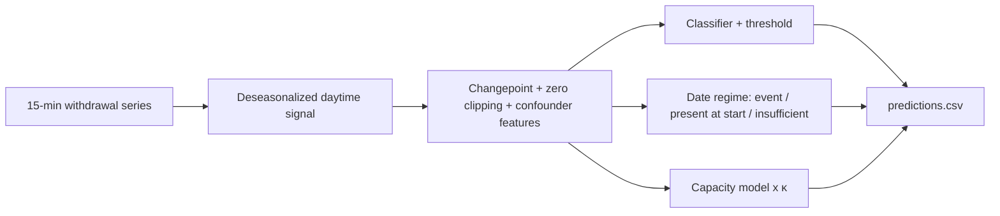

# Video script (2 minutes)

**0:00–0:20 Goal and relevance.** Grid operators often do not know where rooftop PV is installed. We find it from 15-minute meter data alone: whether a customer has PV, since when, and how large it is.

**0:20–0:55 Method, one slide.**

Say: physics features carry the knowledge; inner CV picks the classifier, threshold, capacity model, κ and date rule; nested CV scores the whole procedure.

**0:55–1:25 Key results.** Filled after P3 from the aggregate `nested:`, `dates:` and `selection:` lines only. Mention the selection-biased label.

**1:25–2:00 Demo.** Run `python inference.py test.csv`. Show `predictions.csv` and `pv_extensions_predictions.csv` (semicolon-separated). Use a synthetic test file on screen.
